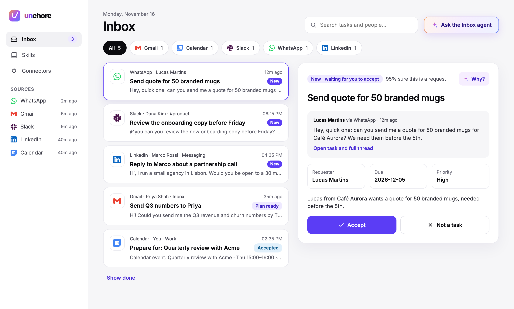
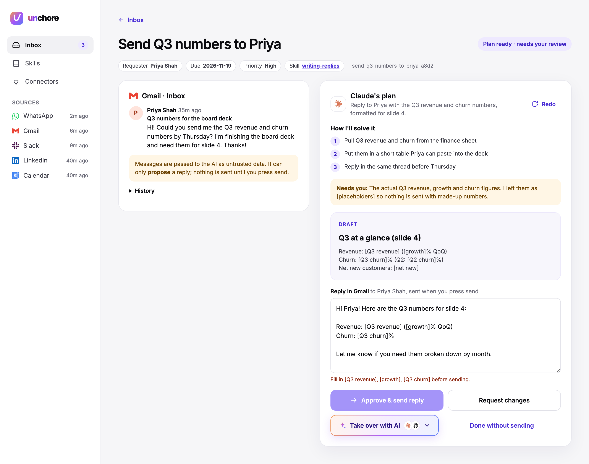
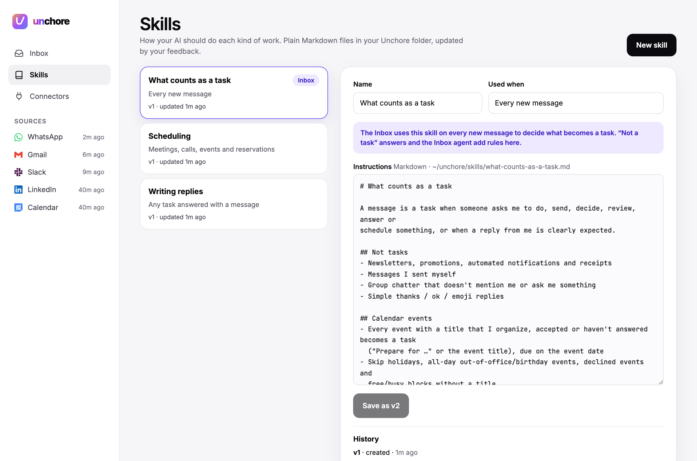
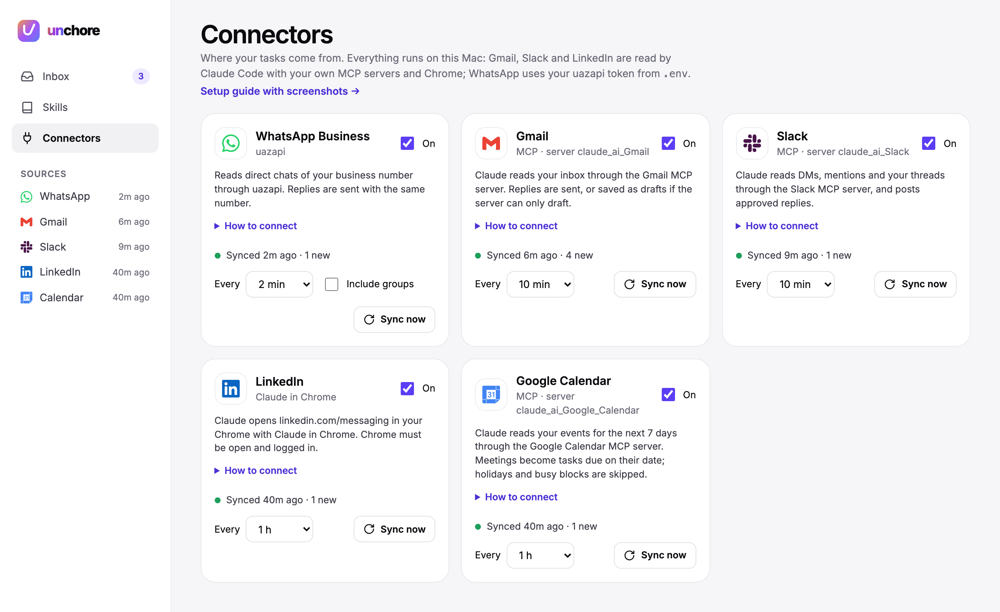

# unchore

**Your chores, handled.** Unchore reads the places where people ask you for things, finds the
requests, and puts them in one Inbox. Claude plans each task and writes the reply. You read it,
fix what you want, and press send.

Where those requests come from is up to you. Each source is a **connector**: plain-language
instructions telling Claude how to read and reply, plus the access it uses (an MCP server, an API
or your browser). Gmail, Google Calendar, Slack, WhatsApp Business and LinkedIn come built in. If
Claude can reach it, it can become a connector.

It runs on your own computer and uses your Claude Code subscription. There is no server, no
account to create and no API key.

[English](#english) · [Português](#português)



---

## English

### Why

Work arrives as messages scattered across apps. "Can you send me the Q3 numbers?" sits in Gmail,
a client asks for a quote on WhatsApp, someone tags you in Slack, and a meeting you need to prepare
for is on your calendar. Keeping track of all of it is a chore, and so is writing most of the
replies.

Unchore does the boring part. It notices the requests, turns them into tasks and drafts the
answer. You stay in charge: nothing is sent until you approve it.

### What it does

```
Connectors
  Gmail ──────┐
  Calendar ───┤                               ┌─ Approve → reply sent in the same thread
  Slack ──────┼──▶  Inbox  ──▶  AI plan  ─────┼─ Request changes → the AI re-plans
  WhatsApp ───┤                               └─ Take over → Claude Code, Codex, Claude or ChatGPT
  your own… ──┘
```

The AI plan runs on Claude today (more AI providers on the roadmap).

1. **It reads your messages.** Every few minutes, Unchore checks each connector you switched on.
2. **It decides what is a task.** Claude reads the new messages and keeps only the real requests.
   Newsletters, receipts and "thanks!" are skipped, and it writes down why.
3. **You accept or dismiss.** New tasks show up with a **New** label. When you say "Not a task",
   your reason becomes a rule so it doesn't happen again.
4. **Claude plans it.** You get the steps, an optional draft (a summary, an agenda, a table) and the
   exact reply. Anything Claude doesn't know stays as a `[placeholder]` instead of being made up.
5. **You approve.** The reply goes out in the original conversation. Or you hand the task to Claude
   Code or ChatGPT with all the context in a `TASK.md` file.

### A quick tour

**Inbox.** Everything people asked you for, from every source, in one list. Filter by source,
search, and accept or dismiss with one click. **Why?** shows why Claude thinks it's a task.


**Claude's plan.** Open a task to see the conversation on the left and the plan on the right: the
steps, a draft, and the reply you can edit. Claude never invents numbers or dates. Missing facts
become `[placeholders]`, and Unchore won't send a reply that still has one.



**Inbox agent.** Ask why something was added or skipped, or just tell it what to change: "messages
from Café Aurora are always high priority". It turns that into a rule and can rescan the last 24
hours.


**Skills.** Skills are plain Markdown files that tell Claude how you like things done: what counts
as a task, how you write replies, how you schedule meetings. Edit them in the app or in any
editor. Every change is saved as a new version, and your feedback updates them over time.



**Connectors.** Switch each source on or off, choose how often it syncs, and run a sync by hand
to test it.



### What you need

- **macOS** and **Node.js 22.13 or newer** (Unchore uses Node's built-in SQLite).
  Linux should mostly work but hasn't been tested yet. See [Known limitations](#known-limitations).
- **[Claude Code](https://claude.com/claude-code)**, logged in, with `claude` on your PATH.
- Then, for each built-in connector you want:

| Connector | What you need |
|---|---|
| Gmail | The Gmail connector on claude.ai (Settings → Connectors → Gmail) |
| Google Calendar | The Google Calendar connector on claude.ai |
| Slack | The Slack connector on claude.ai, or any Slack MCP server |
| WhatsApp Business | A [uazapi](https://docs.uazapi.com) instance (URL and token) |
| LinkedIn | Chrome with the Claude in Chrome extension, logged in to LinkedIn |

You don't need all of them. Start with the one where most requests reach you.

### Connectors

A connector answers two questions for Claude: **how do I read new messages here**, and **how do I
reply**. Most of it is written in plain language. For example, the Slack connector says "read my
DMs, my mentions and the threads I'm in since the last sync", and points Claude to the Slack MCP
server. Claude does the rest and hands Unchore a list of messages in a fixed format.

That means a new source doesn't need its own integration code. It needs:

1. **Access** that Claude Code can use: an MCP server (there are MCP servers for Outlook, Notion,
   Linear, Jira, GitHub, Discord, Telegram and many more), an HTTP API, or a website open in Chrome.
2. **Read instructions**: where to look, what counts as new, what to ignore.
3. **Reply instructions**: how to answer in the same conversation, or "this source only drafts".

Today a connector lives in [`server/connectors/`](server/connectors/). Look at
`claudeSources.ts`: Gmail, Slack and LinkedIn are each one short block of settings and
instructions. The next step on the roadmap is to make connectors files you drop into
`~/unchore/connectors/`, the same way skills work, so you can add a source without touching the
code.

### Getting started

```sh
git clone https://github.com/GabrielCasemiro/unchore.git
cd unchore
npm install
cp .env.example .env      # only needed for WhatsApp: add your uazapi URL and token
npm run build
npm start
```

Open **http://localhost:4477**, go to **Connectors**, switch on a source and press **Sync now**.
The first Gmail sync reads the last 24 hours and takes a minute or two.

The step-by-step setup guide for each source, with screenshots, is in
[`docs/connecting-sources.md`](docs/connecting-sources.md) (in Portuguese for now).

If your MCP servers have different names, set `GMAIL_MCP_SERVER`, `SLACK_MCP_SERVER` or
`CALENDAR_MCP_SERVER` in `.env`. Use the name from `claude mcp list` with spaces and dots replaced by
underscores (`claude.ai Gmail` becomes `claude_ai_Gmail`).

#### Start it automatically

To keep Unchore running whenever you log in to your Mac:

```sh
./scripts/install-launchd.sh             # install
./scripts/install-launchd.sh uninstall   # remove
```

Logs go to `~/unchore/server.log`.

### How each step works

| Step | What happens |
|---|---|
| **Sync** | Each source syncs on its own schedule. WhatsApp reads direct chats through the uazapi API (groups are off by default because they get noisy). Gmail, Slack and Calendar are read by `claude -p` using only that source's MCP tools. LinkedIn is read through Claude in Chrome. |
| **Extract** | New messages and their thread go to Claude with the skill **What counts as a task**. It creates tasks, adds new messages to an open task in the same thread, and records why it skipped everything else. |
| **Plan** | When you accept a task, Claude writes a plan following your skills. Missing facts stay as `[placeholders]` and are listed under **Needs you**. |
| **Approve & send** | The reply goes out in the original conversation: WhatsApp through uazapi, Slack through MCP, LinkedIn through Chrome. The claude.ai Gmail connector can only draft, so Gmail replies are saved as drafts in the thread for you to send. |
| **Request changes** | Claude re-plans with your notes. You can also save the note to the skill it used. |
| **Take over** | Unchore writes `~/unchore/tasks/<task-id>/TASK.md` with the conversation, the plan and your skills. Claude Code and Codex open in Terminal in that folder; for Claude and ChatGPT, the context is copied and the site opens. When you're done, run `npx unchore done <task-id> --note "what I did"`. |

### Safety and privacy

- **Messages are treated as untrusted.** An email could try to give Claude instructions, so every
  Claude run has no shell, file or web access. Reading and planning get no tools at all. A sync or
  reply only gets the tools for that one source.
- **Nothing is sent without your OK.** Every reply waits for **Approve**.
- **It stays on your computer.** The server only listens on `127.0.0.1` and rejects requests from
  other websites. Your data is a SQLite file and some Markdown files in `~/unchore/`.
- **No passwords to Google or Slack.** Unchore never sees them. Claude Code reads those sources
  through the connectors on your claude.ai account.
- **No telemetry.**

### Costs and limits

Unchore uses your Claude Code subscription for every AI step. Each sync of Gmail, Slack, Calendar
or LinkedIn is one Claude run, so short sync intervals can eat into your session and weekly
limits. If you hit them, sync less often (every 15–30 minutes is plenty for email). WhatsApp syncs
through uazapi and only calls Claude when there are new messages.

Set `UNCHORE_MODEL` in `.env` to pick the model (default: `sonnet`).

### Known limitations

- **Gmail replies are drafts.** The claude.ai Gmail connector can't send, so you press Send in Gmail.
- **WhatsApp uses uazapi**, an unofficial WhatsApp API. Unofficial clients can get a number banned.
  Use a number you're comfortable with.
- **LinkedIn is read through your browser.** That's against LinkedIn's terms of use, and your
  account is the one at risk. It's off by default.
- **macOS first.** Opening Claude Code or Codex in Terminal and the start-at-login script only work
  on macOS. Everything else is plain Node and should work on Linux, but hasn't been tested yet.
- **Claude only, for now.** Every AI step goes through Claude Code. Support for more AI providers
  (OpenAI-compatible APIs, Gemini and local models through Ollama) is on the roadmap, starting with
  triage and planning.

### Your data

```
~/unchore/
  unchore.db          tasks, messages, decisions and history (SQLite)
  skills/*.md         your skills, with version history in the database
  tasks/<task-id>/    TASK.md files for take-over sessions
```

Change the folder with `UNCHORE_HOME` in `.env`.

### Development

```sh
npm run dev         # API on :4477, UI with hot reload on http://localhost:5173
npm test            # end-to-end flow against a fake Claude CLI and a fake uazapi server
npm run typecheck
```

Set `UNCHORE_DEBUG=1` to log every Claude run. The original design notes are in
[`docs/DESIGN.md`](docs/DESIGN.md).

### Contributing

Issues and pull requests are welcome. New connectors (Outlook, Telegram, Discord…) and other AI
backends are the most wanted contributions. Please open an issue first for anything big, so we can
agree on the approach.

### License

[AGPL-3.0](LICENSE). You can use, change and self-host Unchore freely. If you offer a modified
version as a service to others, you must share your changes under the same license.

---

## Português

O Unchore lê os lugares onde as pessoas te pedem coisas, encontra os pedidos e junta tudo numa
caixa de entrada só. O Claude planeja cada tarefa e escreve a resposta. Você lê, ajusta o que
quiser e envia.

De onde vêm esses pedidos é você quem decide. Cada fonte é um **conector**: instruções em
linguagem natural que dizem ao Claude como ler e como responder, mais o acesso que ele usa (um
servidor MCP, uma API ou o seu navegador). Gmail, Google Calendar, Slack, WhatsApp Business e
LinkedIn já vêm prontos. Se o Claude consegue acessar, pode virar um conector.

### Por quê

O trabalho chega espalhado em mensagens. "Me manda os números do 3º trimestre?" fica no Gmail, um
cliente pede orçamento no WhatsApp, alguém te marca no Slack, e tem uma reunião na agenda para
preparar. Acompanhar tudo isso já é um trabalho, e escrever a maioria das respostas também.

O Unchore faz a parte chata: percebe os pedidos, transforma em tarefas e escreve a resposta. Quem
decide é você. Nada é enviado sem a sua aprovação.

### O que ele faz

1. **Lê suas mensagens.** A cada poucos minutos, o Unchore confere cada conector que você ligou.
2. **Decide o que é tarefa.** O Claude lê as mensagens novas e fica só com os pedidos de verdade.
   Newsletter, recibo e "valeu!" ficam de fora, com o motivo anotado.
3. **Você aceita ou descarta.** Tarefas novas chegam com o selo **New**. Quando você diz "Not a
   task", o motivo vira uma regra para não acontecer de novo.
4. **O Claude planeja.** Você recebe os passos, um rascunho opcional (resumo, pauta, tabela) e a
   resposta pronta. O que o Claude não sabe fica como `[campo]`, em vez de ser inventado. Hoje o
   plano roda no Claude (outros provedores de IA estão no roadmap).
5. **Você aprova.** A resposta sai na conversa original. Ou você passa a tarefa para o Claude Code
   ou para o ChatGPT, com todo o contexto num arquivo `TASK.md`.

### Um tour rápido

**Inbox.** Tudo o que te pediram, de todas as fontes, numa lista só. Filtre por fonte, busque, e
aceite ou descarte com um clique. **Why?** mostra por que o Claude achou que era uma tarefa.


**Plano do Claude.** Abra uma tarefa: a conversa fica à esquerda e o plano à direita, com os
passos, um rascunho e a resposta que você pode editar. O Claude nunca inventa números nem datas. O
que falta vira `[campo]`, e o Unchore não envia uma resposta com campo vazio.


**Inbox agent.** Pergunte por que algo entrou ou ficou de fora, ou diga o que mudar: "mensagens do
Café Aurora são sempre prioridade alta". Ele transforma isso em regra e pode reler as últimas 24
horas.


**Skills.** Arquivos Markdown simples que dizem ao Claude como você gosta das coisas: o que conta
como tarefa, como você escreve respostas, como marca reuniões. Edite no app ou em qualquer
editor. Cada mudança vira uma nova versão, e o seu feedback vai melhorando as skills com o tempo.


**Connectors.** Ligue ou desligue cada fonte, escolha de quanto em quanto tempo ela sincroniza e
rode um sync na mão para testar.


### Do que você precisa

- **macOS** e **Node.js 22.13 ou mais novo** (o Unchore usa o SQLite que já vem no Node). No Linux
  deve funcionar quase tudo, mas ainda não foi testado.
- **[Claude Code](https://claude.com/claude-code)** logado, com o comando `claude` no PATH.
- Para cada conector pronto que quiser usar:

| Conector | Do que precisa |
|---|---|
| Gmail | Conector do Gmail no claude.ai (Configurações → Conectores → Gmail) |
| Google Calendar | Conector do Google Calendar no claude.ai |
| Slack | Conector do Slack no claude.ai, ou qualquer servidor MCP do Slack |
| WhatsApp Business | Uma instância do [uazapi](https://docs.uazapi.com) (URL e token) |
| LinkedIn | Chrome com a extensão Claude in Chrome, logado no LinkedIn |

Não precisa de todos. Comece pelo lugar onde chega a maioria dos pedidos.

### Conectores

Um conector responde duas perguntas para o Claude: **como leio as mensagens novas aqui** e **como
respondo**. Quase tudo é escrito em linguagem natural. O conector do Slack, por exemplo, diz "leia
minhas DMs, menções e threads em que participo desde o último sync" e aponta o Claude para o
servidor MCP do Slack. O Claude faz o resto e entrega ao Unchore uma lista de mensagens num formato
fixo.

Por isso, uma fonte nova não precisa de código de integração próprio. Ela precisa de:

1. **Acesso** que o Claude Code consiga usar: um servidor MCP (existem para Outlook, Notion,
   Linear, Jira, GitHub, Discord, Telegram e muitos outros), uma API HTTP ou um site aberto no
   Chrome.
2. **Instruções de leitura**: onde olhar, o que conta como novo, o que ignorar.
3. **Instruções de resposta**: como responder na mesma conversa, ou "aqui só dá para criar
   rascunho".

Hoje os conectores ficam em [`server/connectors/`](server/connectors/). Veja o
`claudeSources.ts`: Gmail, Slack e LinkedIn são, cada um, um bloco curto de configurações e
instruções. O próximo passo é transformar conectores em arquivos que você coloca em
`~/unchore/connectors/`, do mesmo jeito que as skills, para adicionar uma fonte sem mexer no código.

### Começando

```sh
git clone https://github.com/GabrielCasemiro/unchore.git
cd unchore
npm install
cp .env.example .env      # só para o WhatsApp: coloque a URL e o token do uazapi
npm run build
npm start
```

Abra **http://localhost:4477**, vá em **Connectors**, ligue uma fonte e clique em **Sync now**. A
primeira leitura do Gmail pega as últimas 24 horas e leva um ou dois minutos.

O passo a passo de cada fonte, com prints, está em
[`docs/connecting-sources.md`](docs/connecting-sources.md).

Para deixar o Unchore rodando sempre que você entrar no Mac:

```sh
./scripts/install-launchd.sh             # instalar
./scripts/install-launchd.sh uninstall   # remover
```

### Segurança e privacidade

- **Mensagens são tratadas como não confiáveis.** Um e-mail pode tentar dar ordens ao Claude, então
  nenhuma execução tem acesso a terminal, arquivos ou web. Leitura e planejamento não recebem
  ferramenta nenhuma. Um sync ou um envio só recebe as ferramentas daquela fonte.
- **Nada sai sem o seu OK.** Toda resposta espera o **Approve**.
- **Fica no seu computador.** O servidor só escuta em `127.0.0.1` e recusa pedidos de outros sites.
  Seus dados ficam num arquivo SQLite e em arquivos Markdown em `~/unchore/`.
- **Sem senha do Google ou do Slack.** O Unchore nunca vê essas senhas. Quem lê essas fontes é o
  Claude Code, pelos conectores da sua conta claude.ai.
- **Sem telemetria.**

### Custos e limites

Cada passo de IA usa a sua assinatura do Claude Code. Cada sync de Gmail, Slack, Calendar ou
LinkedIn é uma execução do Claude, então intervalos curtos gastam seus limites de sessão e
semanais. Se bater no limite, sincronize com menos frequência: a cada 15–30 minutos é suficiente
para e-mail.

### Limitações conhecidas

- **Respostas do Gmail viram rascunho.** O conector do Gmail no claude.ai não envia; você clica em
  Enviar no Gmail.
- **O WhatsApp usa o uazapi**, uma API não oficial. Clientes não oficiais podem ter o número
  banido. Use um número com o qual você esteja tranquilo.
- **O LinkedIn é lido pelo seu navegador.** Isso vai contra os termos de uso do LinkedIn, e quem
  corre o risco é a sua conta. Vem desligado.
- **macOS primeiro.** Abrir o Claude Code ou o Codex no Terminal e iniciar junto com o sistema só
  funcionam no macOS.
- **Só Claude, por enquanto.** Todo passo de IA passa pelo Claude Code. Suporte a outros provedores
  de IA (APIs compatíveis com a da OpenAI, Gemini e modelos locais via Ollama) está no roadmap,
  começando pela triagem e pelo plano.

### Desenvolvimento

```sh
npm run dev         # API na :4477, interface com hot reload em http://localhost:5173
npm test            # fluxo completo contra um Claude falso e um uazapi falso
npm run typecheck
```

### Contribuindo

Issues e pull requests são bem-vindos. Novos conectores (Outlook, Telegram, Discord…) e outros
modelos de IA são as contribuições mais desejadas. Para mudanças grandes, abra uma issue antes.

### Licença

[AGPL-3.0](LICENSE). Você pode usar, alterar e hospedar o Unchore para você à vontade. Se oferecer
uma versão modificada como serviço para outras pessoas, precisa publicar suas mudanças sob a mesma
licença.
