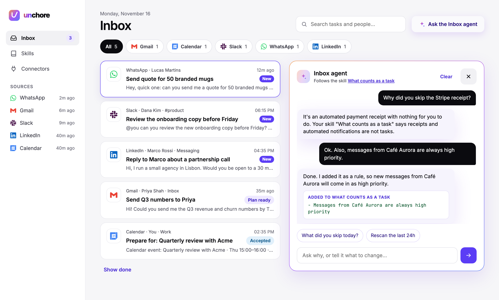

<h1 align="center">
  <picture>
    <source media="(prefers-color-scheme: dark)" srcset="docs/images/logo-dark.svg">
    
  </picture>
</h1>

<p align="center"><b>Your chores, handled.</b></p>

<p align="center">English · <a href="README.pt-BR.md">Português</a></p>

Unchore reads the places where people ask you for things, finds the requests, and puts them in
one Inbox. Claude plans each task and writes the reply. You read it, fix what you want, and press
send.

Where those requests come from is up to you. Each source is a **connector**: plain-language
instructions telling Claude how to read and reply, plus the access it uses (an MCP server, an API
or your browser). Gmail, Google Calendar, Slack, WhatsApp Business and LinkedIn come built in. If
Claude can reach it, it can become a connector.

It runs on your own computer and uses your Claude Code subscription. There is no server, no
account to create and no API key.


## Why

Work arrives as messages scattered across apps. "Can you send me the Q3 numbers?" sits in Gmail,
a client asks for a quote on WhatsApp, someone tags you in Slack, and a meeting you need to prepare
for is on your calendar. Keeping track of all of it is a chore, and so is writing most of the
replies.

Unchore does the boring part. It notices the requests, turns them into tasks and drafts the
answer. You stay in charge: nothing is sent until you approve it.

## What it does

<picture>
  <source media="(prefers-color-scheme: dark)" srcset="docs/images/how-it-works-en-dark.svg">
  
</picture>

The AI plan runs on Claude today (more AI providers on the roadmap).

1. **It reads your messages.** Every few minutes, Unchore checks each connector you switched on.
2. **It decides what is a task.** Claude reads the new messages and keeps only the real requests.
   Newsletters, receipts and "thanks!" are skipped, and it writes down why.
3. **You accept or dismiss.** New tasks show up with a **New** label. When you say "Not a task",
   your reason becomes a rule so it doesn't happen again.
4. **Claude plans it.** You get the steps, an optional draft (a summary, an agenda, a table) and the
   exact reply. Anything Claude doesn't know stays as a `[placeholder]` instead of being made up.
5. **You approve.** The reply goes out in the original conversation. Or you hand the task to Claude
   Code or ChatGPT with all the context in a `TASK.md` file.

## A quick tour

**Inbox.** Everything people asked you for, from every source, in one list. Filter by source,
search, and accept or dismiss with one click. **Why?** shows why Claude thinks it's a task.


**Claude's plan.** Open a task to see the conversation on the left and the plan on the right: the
steps, a draft, and the reply you can edit. Claude never invents numbers or dates. Missing facts
become `[placeholders]`, and Unchore won't send a reply that still has one.


**Inbox agent.** Ask why something was added or skipped, or just tell it what to change: "messages
from Café Aurora are always high priority". It turns that into a rule and can rescan the last 24
hours. Prefer your own AI? Continue the agent in Claude Code, Codex, Claude or ChatGPT: Unchore
writes `AGENT.md` with your rules, open tasks and recent decisions, and the session can add rules
with `npx unchore rule "…"`.



**Skills.** Skills are plain Markdown files that tell Claude how you like things done: what counts
as a task, how you write replies, how you schedule meetings. Edit them in the app or in any
editor. Every change is saved as a new version, and your feedback updates them over time.
The **Library** has ready-made skills (quote requests, meeting prep, follow-ups, status updates)
that you install with one click, and **Export** turns any of yours into a file you can share.


**Connectors.** Switch each source on or off, choose how often it syncs, and run a sync by hand
to test it.


## What you need

- **macOS** and **Node.js 22.13 or newer** (Unchore uses Node's built-in SQLite).
  Linux should mostly work but hasn't been tested yet. See [Known limitations](#known-limitations).
- **[Claude Code](https://claude.com/claude-code)**, logged in, with `claude` on your PATH.
- Then, for each built-in connector you want:

| Connector | What you need |
|---|---|
| Gmail | The Gmail connector on claude.ai (Settings → Connectors → Gmail) |
| Google Calendar | The Google Calendar connector on claude.ai |
| Slack | The Slack connector on claude.ai, or any Slack MCP server |
| WhatsApp Business | A [uazapi](https://docs.uazapi.com) instance (URL and token) |
| LinkedIn | Chrome with the Claude in Chrome extension, logged in to LinkedIn |

You don't need all of them. Start with the one where most requests reach you.

## Connectors

A connector answers two questions for Claude: **how do I read new messages here**, and **how do I
reply**. Most of it is written in plain language. For example, the Slack connector says "read my
DMs, my mentions and the threads I'm in since the last sync", and points Claude to the Slack MCP
server. Claude does the rest and hands Unchore a list of messages in a fixed format.

That means a new source doesn't need its own integration code. It needs:

1. **Access** that Claude Code can use: an MCP server (there are MCP servers for Outlook, Notion,
   Linear, Jira, GitHub, Discord, Telegram and many more), an HTTP API, or a website open in Chrome.
2. **Read instructions**: where to look, what counts as new, what to ignore.
3. **Reply instructions**: how to answer in the same conversation, or "this source only drafts".

Today a connector lives in [`server/connectors/`](server/connectors/). Look at
`claudeSources.ts`: Gmail, Slack and LinkedIn are each one short block of settings and
instructions. The next step on the roadmap is to make connectors files you drop into
`~/unchore/connectors/`, the same way skills work, so you can add a source without touching the
code.

## Getting started

```sh
git clone https://github.com/GabrielCasemiro/unchore.git
cd unchore
npm install
cp .env.example .env      # only needed for WhatsApp: add your uazapi URL and token
npm run build
npm start
```

Prefer a guide? Open the folder in Claude Code and ask it to "set up Unchore for me". The repo's
[`CLAUDE.md`](CLAUDE.md) walks it through checking requirements, connecting your sources and
writing your first skills.

Open **http://localhost:4477**, go to **Connectors**, switch on a source and press **Sync now**.
The first Gmail sync reads the last 24 hours and takes a minute or two.

The step-by-step setup guide for each source, with screenshots, is in
[`docs/connecting-sources.md`](docs/connecting-sources.md) (in Portuguese for now).

If your MCP servers have different names, set `GMAIL_MCP_SERVER`, `SLACK_MCP_SERVER` or
`CALENDAR_MCP_SERVER` in `.env`. Use the name from `claude mcp list` with spaces and dots replaced by
underscores (`claude.ai Gmail` becomes `claude_ai_Gmail`).

### Start it automatically

To keep Unchore running whenever you log in to your Mac:

```sh
./scripts/install-launchd.sh             # install
./scripts/install-launchd.sh uninstall   # remove
```

Logs go to `~/unchore/server.log`.

## How each step works

| Step | What happens |
|---|---|
| **Sync** | Each source syncs on its own schedule. WhatsApp reads direct chats through the uazapi API (groups are off by default because they get noisy). Gmail, Slack and Calendar are read by `claude -p` using only that source's MCP tools. LinkedIn is read through Claude in Chrome. |
| **Extract** | New messages and their thread go to Claude with the skill **What counts as a task**. It creates tasks, adds new messages to an open task in the same thread, and records why it skipped everything else. |
| **Plan** | When you accept a task (optionally with a note for Claude), Claude writes a plan following your skills. Missing facts stay as `[placeholders]` and are listed under **Needs you**. |
| **Approve & send** | The reply goes out in the original conversation: WhatsApp through uazapi, Slack through MCP, LinkedIn through Chrome. The claude.ai Gmail connector can only draft, so Gmail replies are saved as drafts in the thread for you to send. |
| **Request changes** | Claude re-plans with your notes. You can also save the note to the skill it used. |
| **Take over** | Unchore writes `~/unchore/tasks/<task-id>/TASK.md` with the conversation, the plan and your skills. Claude Code and Codex open in Terminal in that folder; for Claude and ChatGPT, the context is copied and the site opens. When you're done, run `npx unchore done <task-id> --note "what I did"`. |

## Safety and privacy

- **Messages are treated as untrusted.** An email could try to give Claude instructions, so Claude
  gets no shell, file or web access unless you grant it. Deciding what is a task never gets tools.
  A sync or reply only gets the tools for that one source.
- **You choose what a plan may look up.** A skill can list a few read-only lookups (a folder, a
  `sqlite3 -safe -readonly` query, one MCP read tool) as Claude Code permission rules. Planning
  gets only those, runs in an empty folder, and anything else is refused. Keep them narrow.
- **Actions wait for you.** A plan can propose actions (add a calendar event, update a record)
  using tools a skill lists for actions. Each one runs only when you press **Approve & run**, and
  that run sees only the approved instructions, not the messages.
- **Tools never travel with a skill.** Export and the Library drop them, so a shared skill can't
  grant anything on your computer.
- **Nothing is sent without your OK.** Every reply waits for **Approve**.
- **It stays on your computer.** The server only listens on `127.0.0.1` and rejects requests from
  other websites. Your data is a SQLite file and some Markdown files in `~/unchore/`.
- **No passwords to Google or Slack.** Unchore never sees them. Claude Code reads those sources
  through the connectors on your claude.ai account.
- **No telemetry.**

## Costs and limits

Unchore uses your Claude Code subscription for every AI step. Each sync of Gmail, Slack, Calendar
or LinkedIn is one Claude run, so short sync intervals can eat into your session and weekly
limits. If you hit them, sync less often (every 15–30 minutes is plenty for email). WhatsApp syncs
through uazapi and only calls Claude when there are new messages.

Set `UNCHORE_MODEL` in `.env` to pick the model (default: `sonnet`). Task titles, summaries and
plans are written in English; set `UNCHORE_LANGUAGE` (for example `Portuguese`) to change that.
Replies always use the language of the conversation.

## Known limitations

- **Gmail replies are drafts.** The claude.ai Gmail connector can't send, so you press Send in Gmail.
- **WhatsApp uses uazapi**, an unofficial WhatsApp API. Unofficial clients can get a number banned.
  Use a number you're comfortable with.
- **LinkedIn is read through your browser.** That's against LinkedIn's terms of use, and your
  account is the one at risk. It's off by default.
- **macOS first.** Opening Claude Code or Codex in Terminal and the start-at-login script only work
  on macOS. Everything else is plain Node and should work on Linux, but hasn't been tested yet.
- **Claude only, for now.** Every AI step goes through Claude Code. Support for more AI providers
  (OpenAI-compatible APIs, Gemini and local models through Ollama) is on the roadmap, starting with
  triage and planning.

## Your data

```
~/unchore/
  unchore.db          tasks, messages, decisions and history (SQLite)
  skills/*.md         your skills, with version history in the database (never in the repo)
  tasks/<task-id>/    TASK.md files for take-over sessions
```

Change the folder with `UNCHORE_HOME` in `.env`.

## Development

```sh
npm run dev         # API on :4477, UI with hot reload on http://localhost:5173
npm test            # end-to-end flow against a fake Claude CLI and a fake uazapi server
npm run typecheck
```

Set `UNCHORE_DEBUG=1` to log every Claude run. The original design notes are in
[`docs/DESIGN.md`](docs/DESIGN.md).

## Contributing

Issues and pull requests are welcome. New connectors (Outlook, Telegram, Discord…), skills for the
library and other AI backends are the most wanted contributions. Please open an issue first for anything big, so we can
agree on the approach. [CONTRIBUTING.md](CONTRIBUTING.md) explains how to run it, how to add a
connector and what a good pull request looks like. To report a security problem, see
[SECURITY.md](SECURITY.md).

## License

[AGPL-3.0](LICENSE). You can use, change and self-host Unchore freely. If you offer a modified
version as a service to others, you must share your changes under the same license.
