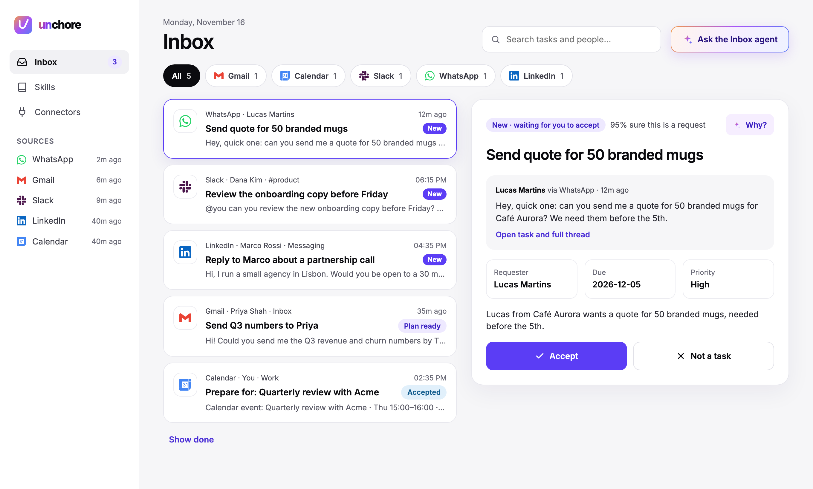
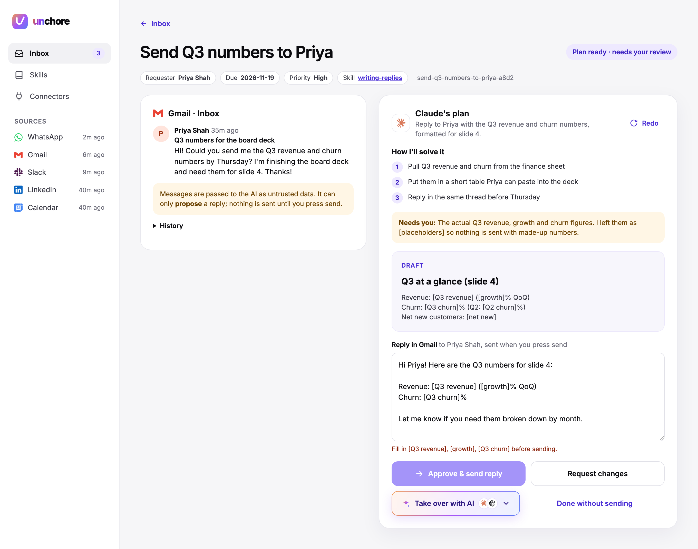
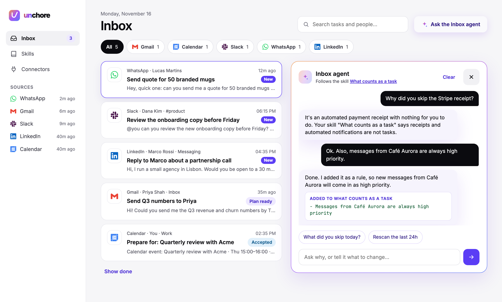
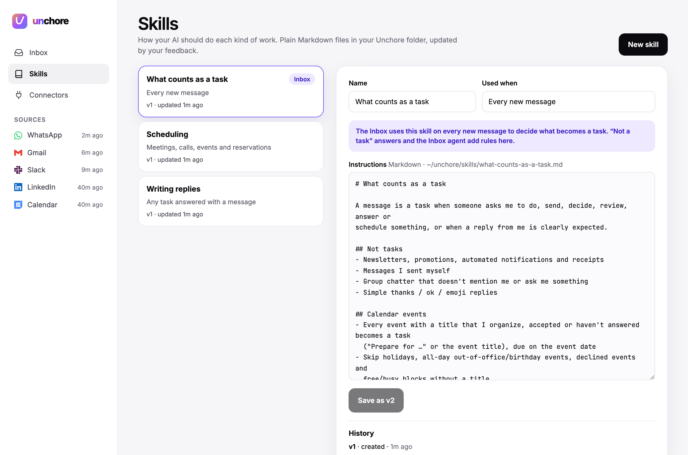
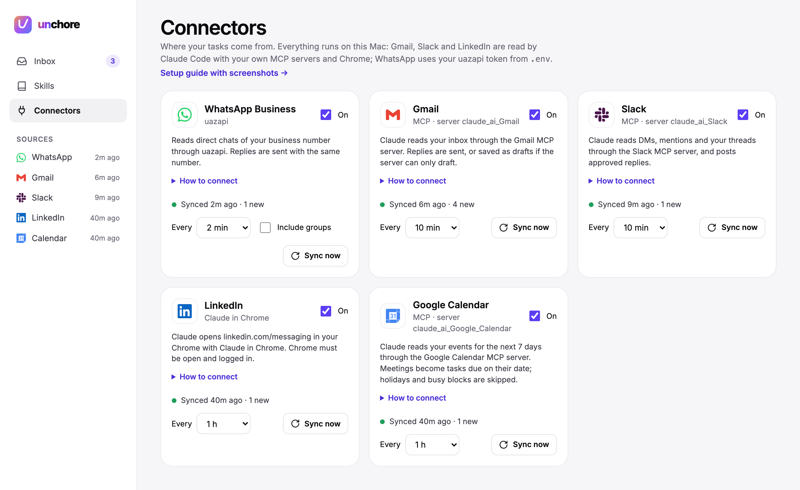

<h1 align="center">
  <picture>
    <source media="(prefers-color-scheme: dark)" srcset="docs/images/logo-dark.svg">
    
  </picture>
</h1>

<p align="center"><b>Suas tarefas chatas, resolvidas.</b></p>

<p align="center"><a href="README.md">English</a> · Português</p>

O Unchore lê os lugares onde as pessoas te pedem coisas, encontra os pedidos e junta tudo numa
caixa de entrada só. O Claude planeja cada tarefa e escreve a resposta. Você lê, ajusta o que
quiser e envia.

De onde vêm esses pedidos é você quem decide. Cada fonte é um **conector**: instruções em
linguagem natural que dizem ao Claude como ler e como responder, mais o acesso que ele usa (um
servidor MCP, uma API ou o seu navegador). Gmail, Google Calendar, Slack, WhatsApp Business e
LinkedIn já vêm prontos. Se o Claude consegue acessar, pode virar um conector.

Roda no seu próprio computador e usa a sua assinatura do Claude Code. Não tem servidor, conta para
criar nem chave de API.



## Por quê

O trabalho chega espalhado em mensagens. "Me manda os números do 3º trimestre?" fica no Gmail, um
cliente pede orçamento no WhatsApp, alguém te marca no Slack, e tem uma reunião na agenda para
preparar. Acompanhar tudo isso já é um trabalho, e escrever a maioria das respostas também.

O Unchore faz a parte chata: percebe os pedidos, transforma em tarefas e escreve a resposta. Quem
decide é você. Nada é enviado sem a sua aprovação.

## O que ele faz

<picture>
  <source media="(prefers-color-scheme: dark)" srcset="docs/images/how-it-works-pt-dark.svg">
  
</picture>

Hoje o plano roda no Claude (outros provedores de IA estão no roadmap).

1. **Lê suas mensagens.** A cada poucos minutos, o Unchore confere cada conector que você ligou.
2. **Decide o que é tarefa.** O Claude lê as mensagens novas e fica só com os pedidos de verdade.
   Newsletter, recibo e "valeu!" ficam de fora, com o motivo anotado.
3. **Você aceita ou descarta.** Tarefas novas chegam com o selo **New**. Quando você diz "Not a
   task", o motivo vira uma regra para não acontecer de novo.
4. **O Claude planeja.** Você recebe os passos, um rascunho opcional (resumo, pauta, tabela) e a
   resposta pronta. O que o Claude não sabe fica como `[campo]`, em vez de ser inventado.
5. **Você aprova.** A resposta sai na conversa original. Ou você passa a tarefa para o Claude Code
   ou para o ChatGPT, com todo o contexto num arquivo `TASK.md`.

## Um tour rápido

**Inbox.** Tudo o que te pediram, de todas as fontes, numa lista só. Filtre por fonte, busque, e
aceite ou descarte com um clique. **Why?** mostra por que o Claude achou que era uma tarefa.


**Plano do Claude.** Abra uma tarefa: a conversa fica à esquerda e o plano à direita, com os
passos, um rascunho e a resposta que você pode editar. O Claude nunca inventa números nem datas. O
que falta vira `[campo]`, e o Unchore não envia uma resposta com campo vazio.



**Inbox agent.** Pergunte por que algo entrou ou ficou de fora, ou diga o que mudar: "mensagens do
Café Aurora são sempre prioridade alta". Ele transforma isso em regra e pode reler as últimas 24
horas.



**Skills.** Arquivos Markdown simples que dizem ao Claude como você gosta das coisas: o que conta
como tarefa, como você escreve respostas, como marca reuniões. Edite no app ou em qualquer
editor. Cada mudança vira uma nova versão, e o seu feedback vai melhorando as skills com o tempo.
A **Library** tem skills prontas (orçamentos, preparação de reuniões, follow-ups, atualizações de
status) que você instala com um clique, e o **Export** transforma qualquer skill sua em um arquivo
para compartilhar.



**Connectors.** Ligue ou desligue cada fonte, escolha de quanto em quanto tempo ela sincroniza e
rode um sync na mão para testar.



## Do que você precisa

- **macOS** e **Node.js 22.13 ou mais novo** (o Unchore usa o SQLite que já vem no Node). No Linux
  deve funcionar quase tudo, mas ainda não foi testado. Veja as
  [limitações conhecidas](#limitações-conhecidas).
- **[Claude Code](https://claude.com/claude-code)** logado, com o comando `claude` no PATH.
- Para cada conector pronto que quiser usar:

| Conector | Do que precisa |
|---|---|
| Gmail | Conector do Gmail no claude.ai (Configurações → Conectores → Gmail) |
| Google Calendar | Conector do Google Calendar no claude.ai |
| Slack | Conector do Slack no claude.ai, ou qualquer servidor MCP do Slack |
| WhatsApp Business | Uma instância do [uazapi](https://docs.uazapi.com) (URL e token) |
| LinkedIn | Chrome com a extensão Claude in Chrome, logado no LinkedIn |

Não precisa de todos. Comece pelo lugar onde chega a maioria dos pedidos.

## Conectores

Um conector responde duas perguntas para o Claude: **como leio as mensagens novas aqui** e **como
respondo**. Quase tudo é escrito em linguagem natural. O conector do Slack, por exemplo, diz "leia
minhas DMs, menções e threads em que participo desde o último sync" e aponta o Claude para o
servidor MCP do Slack. O Claude faz o resto e entrega ao Unchore uma lista de mensagens num formato
fixo.

Por isso, uma fonte nova não precisa de código de integração próprio. Ela precisa de:

1. **Acesso** que o Claude Code consiga usar: um servidor MCP (existem para Outlook, Notion,
   Linear, Jira, GitHub, Discord, Telegram e muitos outros), uma API HTTP ou um site aberto no
   Chrome.
2. **Instruções de leitura**: onde olhar, o que conta como novo, o que ignorar.
3. **Instruções de resposta**: como responder na mesma conversa, ou "aqui só dá para criar
   rascunho".

Hoje os conectores ficam em [`server/connectors/`](server/connectors/). Veja o
`claudeSources.ts`: Gmail, Slack e LinkedIn são, cada um, um bloco curto de configurações e
instruções. O próximo passo é transformar conectores em arquivos que você coloca em
`~/unchore/connectors/`, do mesmo jeito que as skills, para adicionar uma fonte sem mexer no código.

## Começando

```sh
git clone https://github.com/GabrielCasemiro/unchore.git
cd unchore
npm install
cp .env.example .env      # só para o WhatsApp: coloque a URL e o token do uazapi
npm run build
npm start
```

Prefere ajuda? Abra a pasta no Claude Code e peça "configura o Unchore pra mim". O
[`CLAUDE.md`](CLAUDE.md) do repositório guia o Claude para conferir os requisitos, conectar suas
fontes e escrever as suas primeiras skills.

Abra **http://localhost:4477**, vá em **Connectors**, ligue uma fonte e clique em **Sync now**. A
primeira leitura do Gmail pega as últimas 24 horas e leva um ou dois minutos.

O passo a passo de cada fonte, com prints, está em
[`docs/connecting-sources.md`](docs/connecting-sources.md).

Se os seus servidores MCP tiverem outros nomes, defina `GMAIL_MCP_SERVER`, `SLACK_MCP_SERVER` ou
`CALENDAR_MCP_SERVER` no `.env`. Use o nome que aparece em `claude mcp list`, trocando espaços e
pontos por `_` (`claude.ai Gmail` vira `claude_ai_Gmail`).

### Iniciar junto com o Mac

Para deixar o Unchore rodando sempre que você entrar no Mac:

```sh
./scripts/install-launchd.sh             # instalar
./scripts/install-launchd.sh uninstall   # remover
```

Os logs ficam em `~/unchore/server.log`.

## Como cada etapa funciona

| Etapa | O que acontece |
|---|---|
| **Sync** | Cada fonte sincroniza no seu próprio intervalo. O WhatsApp lê as conversas diretas pela API do uazapi (grupos vêm desligados porque fazem muito barulho). Gmail, Slack e Calendar são lidos pelo `claude -p` usando só as ferramentas MCP daquela fonte. O LinkedIn é lido pelo Claude in Chrome. |
| **Extract** | As mensagens novas e a conversa delas vão para o Claude junto com a skill **What counts as a task**. Ele cria tarefas, junta mensagens novas a uma tarefa aberta da mesma conversa e anota por que ignorou o resto. |
| **Plan** | Quando você aceita uma tarefa (se quiser, com um comentário para o Claude), o Claude escreve um plano seguindo as suas skills. O que falta fica como `[campo]` e aparece em **Needs you**. |
| **Approve & send** | A resposta sai na conversa original: WhatsApp pelo uazapi, Slack pelo MCP, LinkedIn pelo Chrome. O conector do Gmail no claude.ai só cria rascunhos, então a resposta do Gmail fica salva como rascunho na conversa para você enviar. |
| **Request changes** | O Claude refaz o plano com as suas notas. Você também pode salvar a nota na skill que ele usou. |
| **Take over** | O Unchore grava `~/unchore/tasks/<id-da-tarefa>/TASK.md` com a conversa, o plano e as suas skills. Claude Code e Codex abrem no Terminal nessa pasta; para Claude e ChatGPT, o contexto é copiado e o site abre. Quando terminar, rode `npx unchore done <id-da-tarefa> --note "o que eu fiz"`. |

## Segurança e privacidade

- **Mensagens são tratadas como não confiáveis.** Um e-mail pode tentar dar ordens ao Claude, então
  nenhuma execução tem acesso a terminal, arquivos ou web. Leitura e planejamento não recebem
  ferramenta nenhuma. Um sync ou um envio só recebe as ferramentas daquela fonte.
- **Nada sai sem o seu OK.** Toda resposta espera o **Approve**.
- **Fica no seu computador.** O servidor só escuta em `127.0.0.1` e recusa pedidos de outros sites.
  Seus dados ficam num arquivo SQLite e em arquivos Markdown em `~/unchore/`.
- **Sem senha do Google ou do Slack.** O Unchore nunca vê essas senhas. Quem lê essas fontes é o
  Claude Code, pelos conectores da sua conta claude.ai.
- **Sem telemetria.**

## Custos e limites

Cada passo de IA usa a sua assinatura do Claude Code. Cada sync de Gmail, Slack, Calendar ou
LinkedIn é uma execução do Claude, então intervalos curtos gastam seus limites de sessão e
semanais. Se bater no limite, sincronize com menos frequência: a cada 15–30 minutos é suficiente
para e-mail. O WhatsApp sincroniza pelo uazapi e só chama o Claude quando chegam mensagens novas.

Para escolher o modelo, defina `UNCHORE_MODEL` no `.env` (padrão: `sonnet`). Títulos, resumos e
planos das tarefas saem em inglês; para mudar, defina `UNCHORE_LANGUAGE` (por exemplo `Portuguese`).
As respostas sempre usam o idioma da conversa.

## Limitações conhecidas

- **Respostas do Gmail viram rascunho.** O conector do Gmail no claude.ai não envia; você clica em
  Enviar no Gmail.
- **O WhatsApp usa o uazapi**, uma API não oficial. Clientes não oficiais podem ter o número
  banido. Use um número com o qual você esteja tranquilo.
- **O LinkedIn é lido pelo seu navegador.** Isso vai contra os termos de uso do LinkedIn, e quem
  corre o risco é a sua conta. Vem desligado.
- **macOS primeiro.** Abrir o Claude Code ou o Codex no Terminal e iniciar junto com o sistema só
  funcionam no macOS. O resto é Node puro e deve funcionar no Linux, mas ainda não foi testado.
- **Só Claude, por enquanto.** Todo passo de IA passa pelo Claude Code. Suporte a outros provedores
  de IA (APIs compatíveis com a da OpenAI, Gemini e modelos locais via Ollama) está no roadmap,
  começando pela triagem e pelo plano.

## Seus dados

```
~/unchore/
  unchore.db             tarefas, mensagens, decisões e histórico (SQLite)
  skills/*.md            suas skills, com histórico de versões no banco (nunca vão para o repo)
  tasks/<id-da-tarefa>/  arquivos TASK.md para continuar a tarefa em outra ferramenta
```

Para mudar a pasta, defina `UNCHORE_HOME` no `.env`.

## Desenvolvimento

```sh
npm run dev         # API na :4477, interface com hot reload em http://localhost:5173
npm test            # fluxo completo contra um Claude falso e um uazapi falso
npm run typecheck
```

Defina `UNCHORE_DEBUG=1` para registrar cada execução do Claude. As notas de design originais estão
em [`docs/DESIGN.md`](docs/DESIGN.md).

## Contribuindo

Issues e pull requests são bem-vindos. Novos conectores (Outlook, Telegram, Discord…) e outros
modelos de IA são as contribuições mais desejadas. Para mudanças grandes, abra uma issue antes para
combinarmos a abordagem. O [CONTRIBUTING.md](CONTRIBUTING.md) (em inglês) explica como rodar o
projeto, como criar um conector e o que se espera de um pull request. Para reportar um problema de
segurança, veja o [SECURITY.md](SECURITY.md).

## Licença

[AGPL-3.0](LICENSE). Você pode usar, alterar e hospedar o Unchore para você à vontade. Se oferecer
uma versão modificada como serviço para outras pessoas, precisa publicar suas mudanças sob a mesma
licença.
