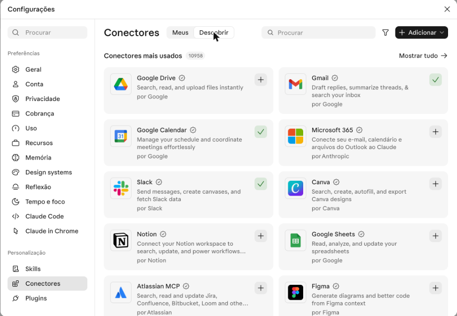
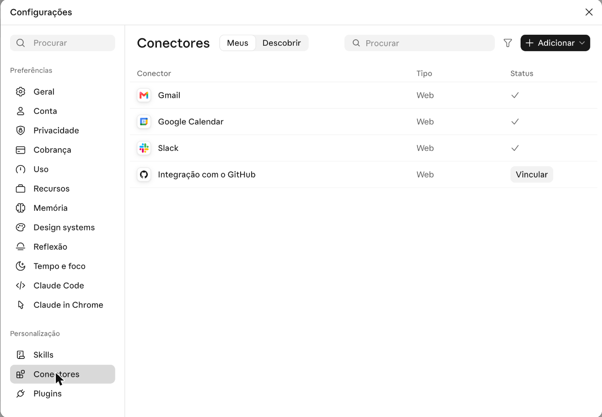
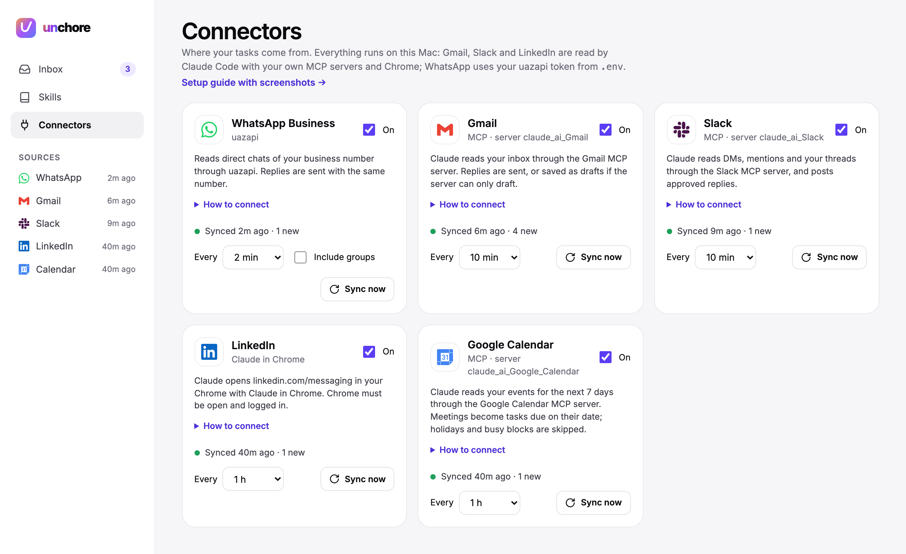
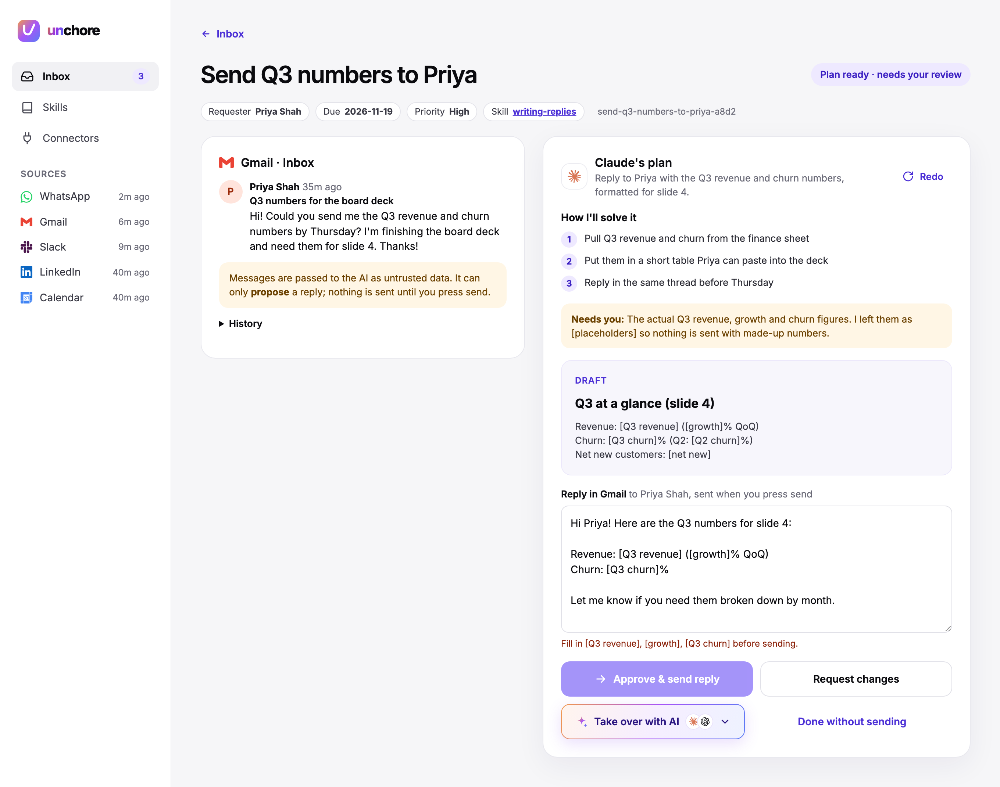

# Connecting your sources to Unchore

<p align="center">English · <a href="connecting-sources.pt-BR.md">Português</a></p>

This guide shows how to connect **Gmail, Google Calendar, Slack, WhatsApp Business and LinkedIn**
to Unchore, and how to review and send replies afterwards.

Unchore does not store your Google or Slack password or token. **Claude Code** (`claude -p`) reads
those sources. It runs on your Mac and uses the **connectors of your claude.ai account**. Connect
once on claude.ai, and Unchore sees the connector automatically.

| Source | How Unchore reads it | Where to set it up |
|---|---|---|
| Gmail | Claude + **Gmail** connector (MCP) | claude.ai → Connectors |
| Google Calendar | Claude + **Google Calendar** connector (MCP): events in the next 7 days become tasks | claude.ai → Connectors |
| Slack | Claude + **Slack** connector (MCP) | claude.ai → Connectors |
| WhatsApp Business | uazapi API | `.env` file |
| LinkedIn | Claude in Chrome | Chrome extension |

---

## 1. Gmail and Google Calendar

### On claude.ai

1. Open **claude.ai → Settings → Customize → Connectors**.
2. Click **Discover**, find **Gmail** and click **+**.
3. Sign in with your Google account and allow access.
4. Repeat for **Google Calendar**.



Once connected, they show up in the **Mine** tab with a ✓:



### Check in the terminal

```sh
claude mcp list
```

You should see:

```
claude.ai Gmail: https://gmailmcp.googleapis.com/mcp/v1 - ✔ Connected
claude.ai Google Calendar: https://calendarmcp.googleapis.com/mcp/v1 - ✔ Connected
```

### In Unchore

1. Open **http://localhost:4477 → Connectors**.
2. On the **Gmail** card, switch **On** and click **Sync now**. The first sync reads the last
   24 hours and takes about 1–2 minutes.



> **Gmail only creates drafts.** The official Gmail connector on claude.ai can't send email
> ("Draft replies…"). When you approve an email reply, Unchore **saves it as a draft** in the Gmail
> thread. Then open Gmail and click Send. The task history shows "Reply saved as draft".

### Google Calendar → this week's tasks

On the **Google Calendar** card, switch **On**. Every hour, Unchore reads your events for the
**next 7 days**. Each event becomes a task in the Inbox, due on the day of the event. When you
accept it, Claude builds a preparation plan (agenda, questions, materials).

The **Calendar events** section of the **What counts as a task** skill decides which events become
tasks. By default:

- events with a title that you organize, accepted or haven't answered yet become tasks;
- holidays, all-day absence or birthday events, declined events and untitled "busy" blocks (from
  calendars where you only see free/busy) are ignored.

To change this, edit the skill under **Skills**, use **Not a task** on an event (for example, a
recurring daily), or ask the **Inbox agent** ("ignore events from calendar X"). Calendar tasks have
no reply to send. Use **Done** when you finish.

---

## 2. Slack

1. **claude.ai → Settings → Customize → Connectors → Discover → Slack → +**.
2. Choose the workspace and allow access.
3. Check with `claude mcp list` (`claude.ai Slack: ✔ Connected`).
4. In Unchore, go to **Connectors → Slack** and switch **On**.

Unchore reads only what needs you: **DMs, mentions of you and threads you took part in**. It does
not read whole channels. Approved replies are posted in the same thread.

---

## 3. WhatsApp Business (uazapi)

1. In the uazapi dashboard, copy the **Server URL** and the **instance token**.
2. Put them in the `.env` file at the root of the repository (it is **not** committed to git):

   ```sh
   UAZAPI_URL=https://YOUR-SUBDOMAIN.uazapi.com
   UAZAPI_TOKEN=your-instance-token
   ```

3. Restart Unchore. The WhatsApp card turns on by itself.

By default, Unchore reads only **direct chats**. Groups (especially promotion groups) are noisy.
Switch on **Include groups** on the card if you want them. Approved replies go out from the same
number, as a reply to the person's last message.

---

## 4. LinkedIn (Claude in Chrome)

1. Install the **Claude in Chrome** extension and sign in to LinkedIn in that Chrome.
2. In Unchore, go to **Connectors → LinkedIn** and switch **On**. Once an hour is a good interval.
3. Chrome must be open during the sync. A LinkedIn Messaging tab opens, is read and closes by
   itself.

---

## 5. MCP server names

Unchore finds the connectors by name. The defaults already work with the claude.ai connectors:

| `.env` variable | Default | Comes from (`claude mcp list`) |
|---|---|---|
| `GMAIL_MCP_SERVER` | `claude_ai_Gmail` | `claude.ai Gmail` |
| `SLACK_MCP_SERVER` | `claude_ai_Slack` | `claude.ai Slack` |
| `CALENDAR_MCP_SERVER` | `claude_ai_Google_Calendar` | `claude.ai Google Calendar` |

If you use a different MCP server (for example, a local Gmail server), enter its name with spaces
and dots replaced by `_`.

---

## 6. Reviewing and sending a task

When you accept a task, Claude builds the plan: steps, a draft (when there is a document), the
**reply** and what you still need to provide.



| Button | What it does |
|---|---|
| **Approve & send reply** | Sends the text in the **Reply** box to the original conversation. WhatsApp and Slack send it; Gmail saves a draft. Disabled if the reply is empty or still has `[fields]` to fill in. |
| **Use as reply** | Copies the draft into the reply box so you can edit it. |
| **Request changes** | Sends it back to Claude with your notes (and, if you want, saves the note in the skill). |
| **Take over with AI ▾** | Opens Claude Code or Codex in Terminal with a `TASK.md`, or copies the context for Claude/ChatGPT. Also works on finished tasks. |
| **Done without sending** | Finishes the task without sending anything (for example, if you answered another way). |
| **Reopen** | On finished tasks: puts them back in review. |

Each task has a readable id (for example `send-q3-numbers-to-priya-a8d2`). It is used in the URL
(`http://localhost:4477/#/task/<id>`) and in the CLI:

```sh
npx unchore done send-q3-numbers-to-priya-a8d2 --note "answered by phone"
```

---

## Common problems

| Symptom | What to do |
|---|---|
| The card shows "Last sync failed" | Run `claude mcp list` and check that the connector shows `✔ Connected`. If it doesn't, reconnect it on claude.ai. |
| Sync finishes quickly with "0 new" | There may be no new messages. To see what Claude did, start with `UNCHORE_DEBUG=1 npm start`. |
| LinkedIn reads nothing | Is Chrome open, with the Claude in Chrome extension on and LinkedIn signed in? |
| WhatsApp: "Set UAZAPI_URL…" | Fill in the `.env` file and restart Unchore. |
| Gmail doesn't "send" | This is expected: the claude.ai connector creates a draft. Open Gmail and send it. |
