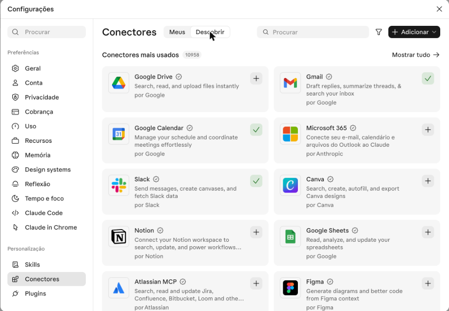
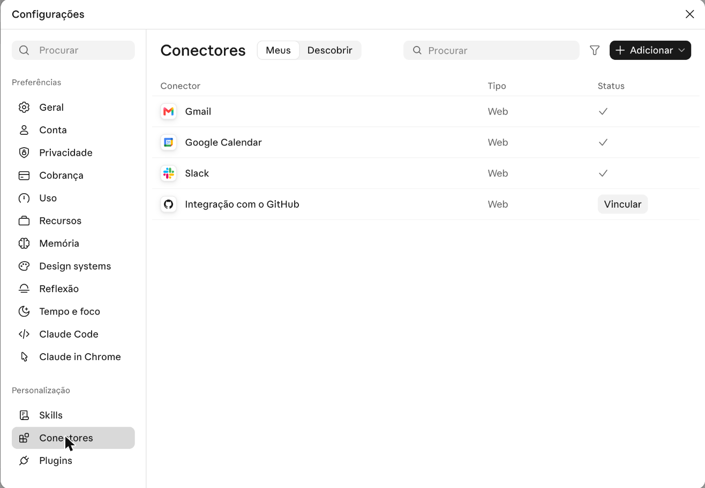
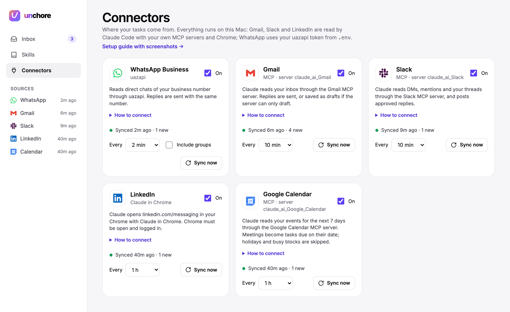
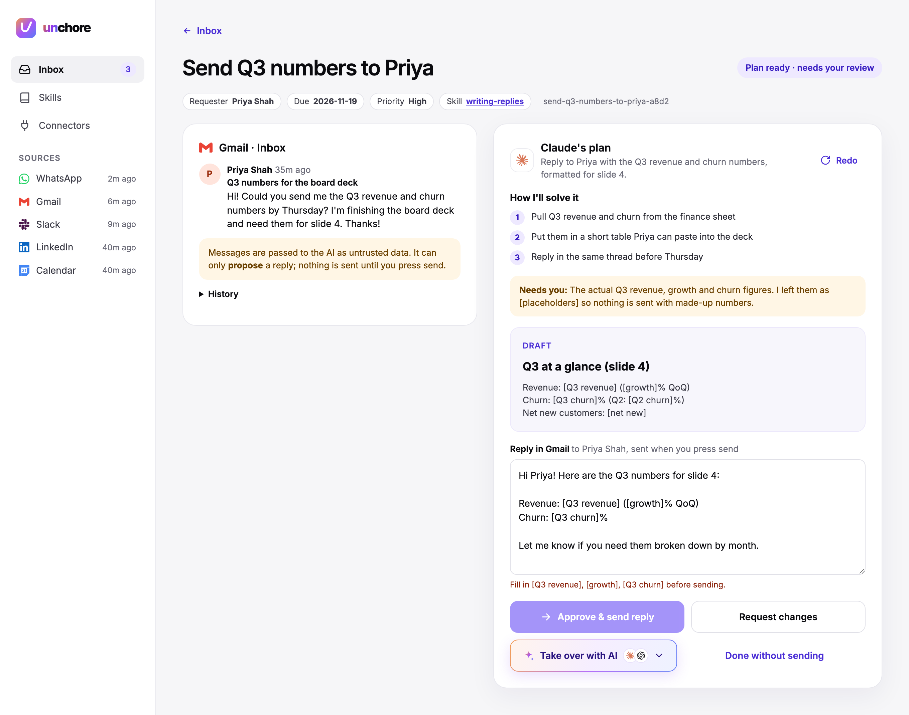

# Conectando suas fontes ao Unchore

<p align="center"><a href="connecting-sources.md">English</a> · Português</p>

Este guia mostra como ligar **Gmail, Google Calendar, Slack, WhatsApp Business e LinkedIn** ao
Unchore, e como revisar e enviar as respostas depois.

O Unchore não guarda senha nem token do Google ou do Slack. Quem lê essas fontes é o **Claude
Code** (`claude -p`) rodando no seu Mac, usando os **conectores da sua conta claude.ai**. Basta
conectar uma vez no claude.ai: o Unchore passa a enxergar o conector automaticamente.

| Fonte | Como o Unchore lê | Onde configurar |
|---|---|---|
| Gmail | Claude + conector **Gmail** (MCP) | claude.ai → Conectores |
| Google Calendar | Claude + conector **Google Calendar** (MCP): compromissos dos próximos 7 dias viram tasks | claude.ai → Conectores |
| Slack | Claude + conector **Slack** (MCP) | claude.ai → Conectores |
| WhatsApp Business | API do uazapi | arquivo `.env` |
| LinkedIn | Claude in Chrome | extensão no Chrome |

---

## 1. Gmail e Google Calendar

### No claude.ai

1. Abra **claude.ai → Configurações → Personalização → Conectores**.
2. Clique em **Descobrir**, encontre **Gmail** e clique em **+**.
3. Entre com sua conta Google e autorize o acesso.
4. Repita para o **Google Calendar**.



Depois de conectados, eles aparecem na aba **Meus** com um ✓:



### Confirme no terminal

```sh
claude mcp list
```

Você deve ver:

```
claude.ai Gmail: https://gmailmcp.googleapis.com/mcp/v1 - ✔ Connected
claude.ai Google Calendar: https://calendarmcp.googleapis.com/mcp/v1 - ✔ Connected
```

### No Unchore

1. Abra **http://localhost:4477 → Connectors**.
2. No card **Gmail**, marque **On** e clique em **Sync now**. A primeira leitura pega as últimas
   24h e leva cerca de 1–2 minutos.



> **O Gmail só cria rascunhos.** O conector oficial do Gmail no claude.ai não envia e-mails
> ("Draft replies…"). Quando você aprova uma resposta de e-mail, o Unchore **salva a resposta como
> rascunho** na própria thread do Gmail. Depois é só abrir o Gmail e clicar em Enviar. O histórico
> da task mostra "Reply saved as draft".

### Google Calendar → tasks da semana

No card **Google Calendar**, marque **On**. A cada hora, o Unchore lê seus eventos dos
**próximos 7 dias** e cada compromisso vira uma task no Inbox, com prazo na data do evento. Ao
aceitar, o Claude monta um plano de preparação (pauta, perguntas, materiais).

Quais eventos viram task é decidido pela seção **Calendar events** da skill
**What counts as a task**. O padrão:

- eventos com título que você organiza, aceitou ou ainda não respondeu viram task;
- feriados, eventos de dia inteiro de ausência ou aniversário, eventos recusados e blocos
  "ocupado" sem título (de agendas em que você só vê livre/ocupado) são ignorados.

Para ajustar, edite a skill em **Skills**, use **Not a task** num evento (por exemplo, "daily
recorrente") ou peça ao **Inbox agent** ("ignore eventos da agenda X"). Tasks de agenda não têm
resposta para enviar: use **Done** quando terminar.

---

## 2. Slack

1. **claude.ai → Configurações → Personalização → Conectores → Descobrir → Slack → +**.
2. Escolha o workspace e autorize.
3. Confira com `claude mcp list` (`claude.ai Slack: ✔ Connected`).
4. No Unchore, em **Connectors → Slack**, marque **On**.

O Unchore lê só o que precisa de você: **DMs, menções a você e threads em que você participou**.
Ele não lê canais inteiros. Respostas aprovadas são postadas na mesma thread.

---

## 3. WhatsApp Business (uazapi)

1. No painel do uazapi, copie a **Server URL** e o **token da instância**.
2. No arquivo `.env` na raiz do repositório (ele **não** vai para o git):

   ```sh
   UAZAPI_URL=https://SEU-SUBDOMINIO.uazapi.com
   UAZAPI_TOKEN=seu-token-da-instancia
   ```

3. Reinicie o Unchore. O card do WhatsApp liga sozinho.

Por padrão, só **conversas diretas** são lidas. Grupos (principalmente de promoções) geram muito
ruído; ative **Include groups** no card se quiser lê-los. As respostas aprovadas saem do mesmo
número, como resposta à última mensagem da pessoa.

---

## 4. LinkedIn (Claude in Chrome)

1. Instale a extensão **Claude in Chrome** e faça login no LinkedIn nesse Chrome.
2. No Unchore, em **Connectors → LinkedIn**, marque **On**. Uma vez por hora é um bom intervalo.
3. O Chrome precisa estar aberto durante a sincronização. Uma aba do LinkedIn Messaging abre, é
   lida e fecha sozinha.

---

## 5. Nomes dos servidores MCP

O Unchore procura os conectores por nome. O padrão já funciona com os conectores do claude.ai:

| Variável no `.env` | Padrão | Vem de (`claude mcp list`) |
|---|---|---|
| `GMAIL_MCP_SERVER` | `claude_ai_Gmail` | `claude.ai Gmail` |
| `SLACK_MCP_SERVER` | `claude_ai_Slack` | `claude.ai Slack` |
| `CALENDAR_MCP_SERVER` | `claude_ai_Google_Calendar` | `claude.ai Google Calendar` |

Se você usar outro servidor MCP (por exemplo, um servidor local do Gmail), coloque o nome dele com
espaços e pontos trocados por `_`.

---

## 6. Revisando e enviando uma task

Ao aceitar uma task, o Claude monta o plano: passos, rascunho (quando há um documento), a
**resposta** e o que ainda falta você informar.



| Botão | O que faz |
|---|---|
| **Approve & send reply** | Envia o texto da caixa **Reply** na conversa original: WhatsApp e Slack enviam; Gmail salva rascunho. Fica desabilitado se a resposta estiver vazia ou tiver `[campos]` para preencher. |
| **Use as reply** | Copia o rascunho para a caixa de resposta, para você editar. |
| **Request changes** | Devolve ao Claude com suas notas (e, se quiser, grava a nota na skill). |
| **Take over with AI ▾** | Abre Claude Code ou Codex no Terminal com um `TASK.md`, ou copia o contexto para Claude/ChatGPT. Também funciona em tasks já concluídas. |
| **Done without sending** | Conclui sem enviar nada (por exemplo, se você respondeu por fora). |
| **Reopen** | Em tasks concluídas: volta para revisão. |

Cada task tem um id legível (por exemplo `send-q3-numbers-to-priya-a8d2`), usado na
URL (`http://localhost:4477/#/task/<id>`) e na CLI:

```sh
npx unchore done send-q3-numbers-to-priya-a8d2 --note "respondi por telefone"
```

---

## Problemas comuns

| Sintoma | O que fazer |
|---|---|
| Card mostra "Last sync failed" | Rode `claude mcp list` e veja se o conector está `✔ Connected`. Se não estiver, reconecte no claude.ai. |
| Sync termina rápido com "0 new" | Pode não haver mensagens novas. Para ver o que o Claude fez, inicie com `UNCHORE_DEBUG=1 npm start`. |
| LinkedIn não lê nada | O Chrome está aberto, com a extensão Claude in Chrome ativa e logado no LinkedIn? |
| WhatsApp: "Set UAZAPI_URL…" | Preencha o `.env` e reinicie o Unchore. |
| Gmail não "envia" | É esperado: o conector do claude.ai cria rascunho. Abra o Gmail e envie. |
